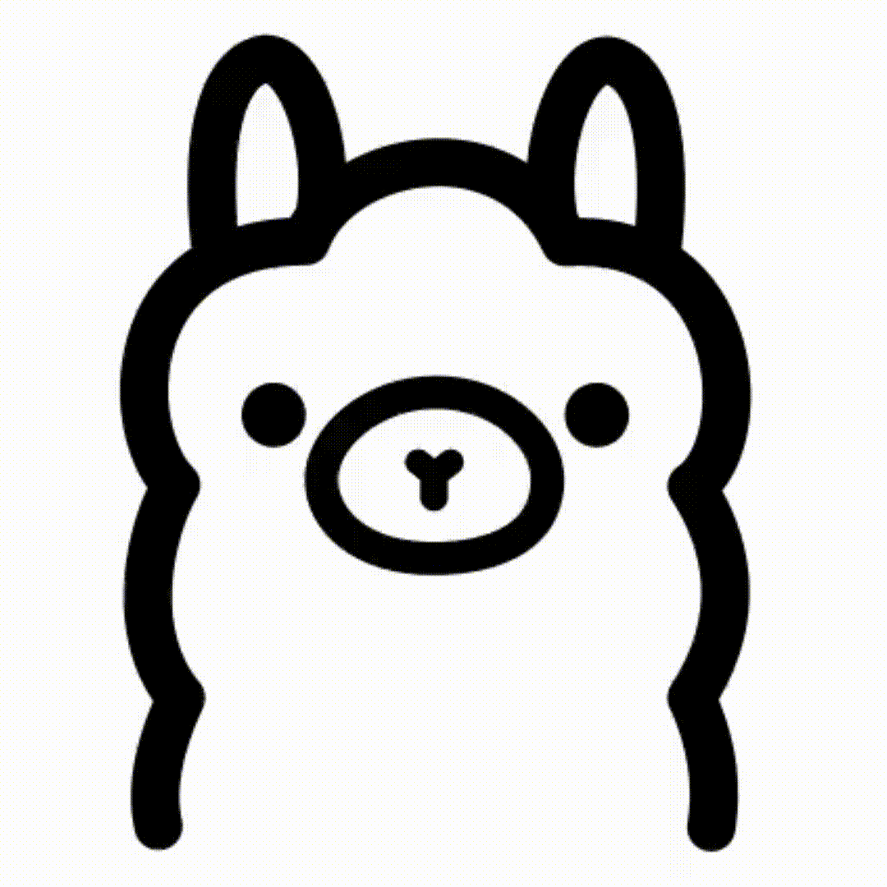

  

## Hi There! 👋

I'm **Nikita**, a **Full-Stack Developer & AI Robotics Engineer**

- 🌐 Developing full-stack web applications
- 🤖 Creating robotic models with AI

## ⚙️ My favorite tools and technologies

> Web Development

<table>
  <tr>
    <td align="center" width="96">
      
       React
    </td>
    <td align="center" width="96">
      
       JavaScript
    </td>
    <td align="center" width="96">
      
       TypeScript
    </td>
    <td align="center" width="96">
      
       HTML
    </td>
    <td align="center" width="96">
      
       CSS
    </td>
    <td align="center" width="96">
      
       Bootstrap
    </td>
    <td align="center" width="96">
      
       Tailwind
    </td>
    <td align="center" width="96">
      
       Python
    </td>
    <td align="center" width="96">
      
       Node.js
    </td>
  </tr>
  <tr>
    <td align="center" width="96">
      
       REST API
    </td>
    <td align="center" width="96">
      
       FastAPI
    </td>
    <td align="center" width="96">
      
       PostgreSQL
    </td>
    <td align="center" width="96">
      
       MySQL
    </td>
    <td align="center" width="96">
      
       Redis
    </td>
    <td align="center" width="96">
      
       Docker
    </td>
    <td align="center" width="96">
      
       Linux
    </td>
    <td align="center" width="96">
      
       Git
    </td>
    <td align="center" width="96">
      
       GitHub
    </td>
  </tr>
</table>

> Robotics

<table>
  <tr>
    <td align="center" width="96">
      
       Fusion
    </td>
    <td align="center" width="96">
      
       Blender
    </td>
    <td align="center" width="96">
      
       Arduino
    </td>
    <td align="center" width="96">
      
       C++
    </td>
    <td align="center" width="96">
      
       Ollama
    </td>
    <td align="center" width="96">
      
       LLM
    </td>
    <td align="center" width="96">
      
       Text-to-Speech
    </td>
    <td align="center" width="96">
      
       Speech-to-Text
    </td>
    <td align="center" width="96">
      
       Machine Vision
    </td>
  </tr>
</table>

## 📚 Projects

> Web Apps

| Repository                                                      | Technologies                                                                           | Description                |
| :-------------------------------------------------------------- | :------------------------------------------------------------------------------------- | :------------------------- |
| [FlowMind AI](https://github.com/nikita-razgulyaev/FlowMind-AI) | React, TypeScript, Vite, Tailwind CSS, Python, FastAPI, Uvicorn, SQLite, Nginx, Ollama | Visual AI Workflow Builder |
| [SmartHub](https://github.com/nikita-razgulyaev/smart-hub)      | HTML, CSS, JavaScript, API                                                             | System Monitoring Panel    |

> Robots

| Repository                                                            | Technologies                                                                                                                               | Description                                                                                                                                                               |
| :-------------------------------------------------------------------- | :----------------------------------------------------------------------------------------------------------------------------------------- | :------------------------------------------------------------------------------------------------------------------------------------------------------------------------ |
| [AI Robotic Owl](https://github.com/nikita-razgulyaev/AI-Robotic-Owl) | **Model:** Arduino. **Server:** React, TypeScript, Python, FastAPI, Uvicorn, WebSocket, Llama-cpp-python, Faster-whisper, Edge-tts, OpenCV | Robotic owl model controlled by ESP32 with 18 servos, microphone, speaker and camera. The model can accept voice commands, respond with voice, and track the user's face. |

## 🌐 Socials

  

