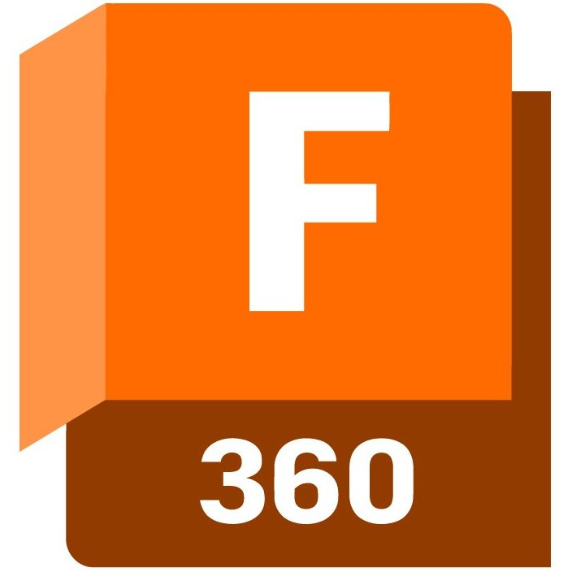
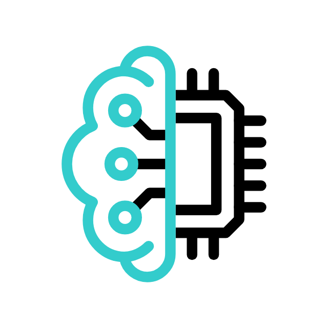

  

## Hi There! 👋

I'm **Nikita**, a **Full-Stack Developer & AI Robotics Engineer**

- 🌐 Developing full-stack web applications
- 🤖 Creating robotic models with AI

## ⚙️ My favorite tools and technologies

> Web Development

<table>
  <tr>
    <td align="center" width="96">
      
       React
    </td>
    <td align="center" width="96">
      
       JavaScript
    </td>
    <td align="center" width="96">
      
       TypeScript
    </td>
    <td align="center" width="96">
      
       HTML
    </td>
    <td align="center" width="96">
      
       CSS
    </td>
    <td align="center" width="96">
      
       Bootstrap
    </td>
    <td align="center" width="96">
      
       Tailwind
    </td>
    <td align="center" width="96">
      
       Python
    </td>
    <td align="center" width="96">
      
       Node.js
    </td>
  </tr>
  <tr>
    <td align="center" width="96">
      
       REST API
    </td>
    <td align="center" width="96">
      
       FastAPI
    </td>
    <td align="center" width="96">
      
       PostgreSQL
    </td>
    <td align="center" width="96">
      
       MySQL
    </td>
    <td align="center" width="96">
      
       Redis
    </td>
    <td align="center" width="96">
      
       Docker
    </td>
    <td align="center" width="96">
      
       Linux
    </td>
    <td align="center" width="96">
      
       Git
    </td>
    <td align="center" width="96">
      
       GitHub
    </td>
  </tr>
</table>

> Robotics

<table>
  <tr>
    <td align="center" width="96">
      
       Fusion
    </td>
    <td align="center" width="96">
      
       Blender
    </td>
    <td align="center" width="96">
      
       Arduino
    </td>
    <td align="center" width="96">
      
       C++
    </td>
    <td align="center" width="96">
      
       Ollama
    </td>
    <td align="center" width="96">
      
       LLM
    </td>
    <td align="center" width="96">
      
       Text-to-Speech
    </td>
    <td align="center" width="96">
      
       Speech-to-Text
    </td>
    <td align="center" width="96">
      
       Machine Vision
    </td>
  </tr>
</table>

## 📚 Projects

> Web Apps

| Repository                                                                | Technologies                                                                                                               | Description                                                                                                   |
| :------------------------------------------------------------------------ | :------------------------------------------------------------------------------------------------------------------------- | :------------------------------------------------------------------------------------------------------------ |
| [FlowMind AI](https://github.com/nikita-razgulyaev/FlowMind-AI)           | React, TypeScript, Vite, Tailwind CSS, Python, FastAPI, Uvicorn, SQLite, Nginx, Ollama                                     | Visual AI workflow builder with a drag-and-drop interface                                                     |
| [AI Robot Server](https://github.com/nikita-razgulyaev/AI-Robot-Server)   | Python, FastAPI, WebSocket, Uvicorn, faster-whisper, llama-cpp-python, Silero, edge-tts, YOLOv8, MediaPipe, OpenCV, Qdrant | Voice AI server for a robotic owl — speech recognition, character LLM, TTS, computer vision and servo control |
| [SmartHub](https://github.com/nikita-razgulyaev/smart-hub)                | React, TypeScript, Tailwind CSS, Zustand, Vite, Axios, Jest                                                                | Real-time system monitoring dashboard                                                                         |
| [API Rate Limiter](https://github.com/nikita-razgulyaev/API-Rate-Limiter) | Node.js, Express, Redis, JavaScript                                                                                        | Multi-strategy API rate limiting demo (Fixed Window, Sliding Window, Token Bucket)                            |
| [BIMPRO](https://github.com/nikita-razgulyaev/BIMPRO)                     | HTML, CSS, JavaScript                                                                                                      | Website for a real estate visualization company                                                               |
| [Interpan](https://github.com/nikita-razgulyaev/Interpan)                 | HTML, CSS, JavaScript                                                                                                      | Website for a fire-resistant decorative panel manufacturer                                                    |
| [Boxrent](https://github.com/nikita-razgulyaev/Boxrent)                   | HTML, CSS, JavaScript                                                                                                      | Website for a container rental and investment company                                                         |

> Bots

| Repository                                                      | Technologies             | Description                                  |
| :-------------------------------------------------------------- | :----------------------- | :------------------------------------------- |
| [booking-bot](https://github.com/nikita-razgulyaev/booking-bot) | Python, Telegram Bot API | Telegram bot for booking client appointments |

> Robots

| Repository                                                            | Technologies                                                                                       | Description                                            |
| :-------------------------------------------------------------------- | :------------------------------------------------------------------------------------------------- | :----------------------------------------------------- |
| [AI Robotic Owl](https://github.com/nikita-razgulyaev/AI-Robotic-Owl) | **Firmware:** Arduino. **Software:** WebSocket, Llama-cpp-python, Faster-whisper, Edge-tts, OpenCV | Robotic owl model with voice control and face tracking |
